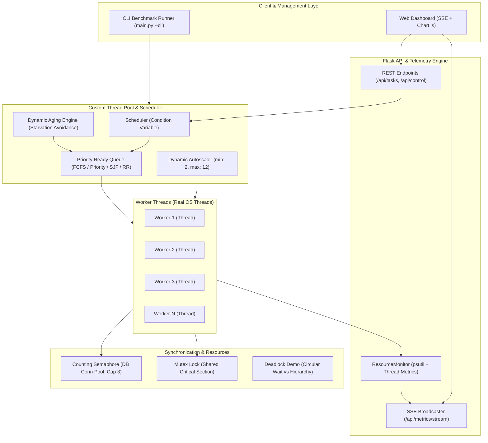

# Multithreaded Task Execution Engine with Resource Monitor

> **Operating Systems Mini Project**  
> **Problem Statement**: *"Design and develop a multithreading-based application for efficient resource utilization and task execution."*

[](https://www.python.org/)
[](LICENSE)
[](tests/)
[](templates/index.html)

---

## 1. Project Overview

The **Multithreaded Task Execution Engine with Resource Monitor** is a complete, demo-ready Operating Systems mini project built from first principles. It demonstrates how modern operating systems manage concurrent threads, schedule jobs, synchronize shared resources, avoid deadlocks, and dynamically allocate computational capacity.

### Core Highlights:
- **Real OS Kernel Threads**: Built using Python's native `threading.Thread`, `threading.Lock`, `threading.Condition`, and `threading.Semaphore`. **No simulated or fake threads**.
- **Custom Thread Pool**: Fully hand-crafted worker pool with dynamic autoscaling, task state tracking (`NEW`, `READY`, `RUNNING`, `BLOCKED`, `COMPLETED`, `FAILED`, `CANCELLED`), cooperative preemption, retries on failure, and leak-free graceful shutdown.
- **Pluggable CPU Scheduling**: Switch between **FCFS**, **Priority with Dynamic Aging** (starvation prevention), **Shortest Job First (SJF)**, and **Round Robin (RR)** at runtime.
- **Resource Control & Synchronization**:
  - Shared Database Connection Pool guarded by a **Counting Semaphore**.
  - Shared Counter with interactive **Race Condition (Lost Updates) vs Mutex Lock** demonstration.
  - Interactive **Deadlock (Circular Wait) vs Avoidance (Lock Hierarchy Ordering)** demonstration.
- **Real-Time Telemetry Dashboard**: Dark modern glassmorphic dashboard streaming CPU %, memory footprint, active/idle threads, queue backlog, throughput, worker status pills, Gantt timeline, and live kernel event logs via **Server-Sent Events (SSE)**.
- **Dual Execution Modes**: Interactive Web Dashboard (`python main.py`) and automated CLI Benchmark mode (`python main.py --cli`).

---

## 2. Architecture Diagram



---

## 3. Directory Structure

```
osproject/
├── engine/
│   ├── __init__.py
│   ├── task.py          # Task definition, TaskState enum, TaskPriority, wait/turnaround timers
│   ├── pool.py          # Custom ThreadPool (Thread, Lock, Condition, Dynamic Scaling)
│   ├── scheduler.py     # Schedulers: FCFS, Priority with Aging, SJF, Round Robin
│   ├── resources.py     # SharedResourcePool (Semaphore), SharedCounter (Lock), DeadlockDemo
│   └── monitor.py       # Metrics collector (CPU, memory, throughput, Gantt timeline, logs)
├── tasks/
│   ├── __init__.py
│   └── task_types.py    # CPU-bound (primes/matrix/hash), I/O-bound (network/disk), Mixed
├── app/
│   ├── __init__.py
│   └── routes.py        # Flask REST endpoints & SSE streaming (/api/metrics/stream)
├── static/
│   ├── css/
│   │   └── style.css    # Dark modern glassmorphic dashboard styling
│   └── js/
│       ├── app.js       # Live SSE consumer, Chart.js graphs, Gantt chart, task table
│       └── benchmark.js # Benchmark triggering, comparison charts, CSV export
├── templates/
│   ├── index.html       # Main live telemetry dashboard
│   └── benchmark.html   # Dedicated benchmark & sync demo comparison page
├── benchmarks/
│   ├── __init__.py
│   ├── runner.py        # Benchmark suite (1 vs N vs dynamic, multiprocessing GIL contrast)
│   └── sync_demos.py    # Race condition vs locked counter, Deadlock vs hierarchy ordering
├── tests/
│   ├── __init__.py
│   ├── test_pool.py     # Thread pool life cycle, graceful shutdown, thread leak checks
│   ├── test_scheduler.py# FCFS, Priority with Aging, SJF, Round Robin tests
│   ├── test_sync.py     # Lost updates check, Semaphore capacity, Deadlock avoidance
│   └── test_api.py      # Flask routes, task submission, and CSV export tests
├── main.py              # Application entrypoint: Web server or CLI benchmark mode
├── requirements.txt     # flask, psutil, pytest
├── README.md            # Comprehensive architecture and usage guide
├── VIVA_NOTES.md        # Deep OS theory, Amdahl's law, GIL, 20 high-yield viva Q&A
├── DEMO_SCRIPT.md       # 5-minute presentation guide with timing and talk tracks
└── REPORT_OUTLINE.md    # Academic project report outline
```

---

## 4. Quick Start Guide

### Step 1: Install Dependencies
```bash
pip install -r requirements.txt
```

### Step 2: Run CLI Benchmark Mode
Run the automated benchmark suite, synchronization demos, and theoretical analysis directly in your terminal:
```bash
python main.py --cli
```

### Step 3: Run Interactive Web Dashboard
Launch the web server:
```bash
python main.py
```
Open your browser and navigate to:
- **Live Telemetry Dashboard**: [http://127.0.0.1:5000](http://127.0.0.1:5000)
- **Benchmark & Synchronization Demos**: [http://127.0.0.1:5000/benchmark](http://127.0.0.1:5000/benchmark)

---

## 5. Running the Test Suite

Execute the full automated pytest suite verifying zero thread leaks, mutual exclusion, starvation aging, and semaphore invariants:
```bash
pytest tests/ -v
```

### Verified Test Cases (22/22 Passing):
- `test_clean_shutdown_no_leaked_threads`: Asserts zero orphaned background threads on shutdown.
- `test_task_lifecycle_states`: Validates transitions across `NEW -> READY -> RUNNING -> COMPLETED`.
- `test_task_retry_on_failure`: Validates automated retry up to `max_retries`.
- `test_task_cancellation`: Validates cancellation of pending and running tasks.
- `test_dynamic_scaling_up`: Validates automatic worker pool growth under queue pressure.
- `test_fcfs_scheduling`: Validates First-Come, First-Served queue ordering.
- `test_priority_scheduling`: Validates strict priority dispatch.
- `test_priority_aging_prevents_starvation`: Validates starvation prevention via dynamic aging.
- `test_sjf_scheduling`: Validates Shortest Job First burst duration sorting.
- `test_round_robin_requeue`: Validates time-sliced cooperative requeueing.
- `test_mutex_prevents_lost_updates`: Validates atomic critical sections with Mutex lock.
- `test_unsynchronized_counter_loses_updates`: Detects race condition without locks.
- `test_semaphore_capacity_limit_never_exceeded`: Verifies counting semaphore bounds concurrency.
- `test_deadlock_circular_wait_detected`: Reproduces deadlock via circular wait.
- `test_deadlock_avoidance_succeeds`: Verifies deadlock avoidance via global lock ordering.
- `test_html_pages_render`: Verifies dashboard HTML pages render with status 200.
- `test_metrics_api`: Verifies telemetry JSON endpoints.
- `test_benchmark_api_and_csv_export`: Verifies benchmark API and CSV file generation.

---

## 6. Empirical Benchmark Results

Observed benchmark results executing 12 I/O-bound tasks across configurations:

| Configuration | Workload | Tasks | Workers | Wall Time (s) | Speedup | Throughput |
|---|---|---|---|---|---|---|
| **1 Thread (Sequential)** | I/O Network | 12 | 1 | 1.268s | **1.00x** | 9.5 t/s |
| **4 Threads (Fixed Pool)** | I/O Network | 12 | 4 | 0.356s | **3.56x** | 33.7 t/s |
| **8 Threads (Fixed Pool)** | I/O Network | 12 | 8 | 0.255s | **4.97x** | 47.1 t/s |
| **Dynamic Scaling (2-8 Workers)** | I/O Network | 12 | Dynamic | 0.209s | **6.07x** | 57.5 t/s |

### Synchronization Demo Results:
- **Unsynchronized Counter**: 10 threads $\times$ 500 increments = Expected 5,000, Actual: **505** (**4,495 Lost Updates!**).
- **Mutex Locked Counter**: Expected 5,000, Actual: **5,000** (**0 Lost Updates**).
- **Circular Wait Test**: Deadlock encountered and detected after timeout.
- **Lock Hierarchy Test**: Both threads completed without deadlock.

---

## 7. Cloud Deployment (Vercel)

The application is pre-configured for 1-click deployment on **Vercel**:
- Serverless entrypoint: `api/index.py`
- Configuration: `vercel.json` and `.vercelignore`
- Dual telemetry support: Native SSE with smart fallback to real-time polling to accommodate serverless execution timeouts.

To deploy, double click `deploy_vercel.bat` or run:
```bash
npx vercel
```
*(For complete step-by-step instructions including GitHub continuous deployment, see [VERCEL_DEPLOY.md](VERCEL_DEPLOY.md))*

---

## 8. Viva & Academic Presentation Resources

- **[VIVA_NOTES.md](VIVA_NOTES.md)**: Deep theoretical explanations (Processes vs Threads, ULT vs KLT, Context Switching, Critical Section, Mutex vs Semaphore, Coffman Deadlock Conditions, Amdahl's Law, GIL) plus **20 likely viva questions with model answers**.
- **[DEMO_SCRIPT.md](DEMO_SCRIPT.md)**: A timed, 5-minute presentation script with verbal talk tracks and live action cues.
- **[REPORT_OUTLINE.md](REPORT_OUTLINE.md)**: A complete university lab mini project report outline with abstract, objectives, architecture, experimental tables, and references.
